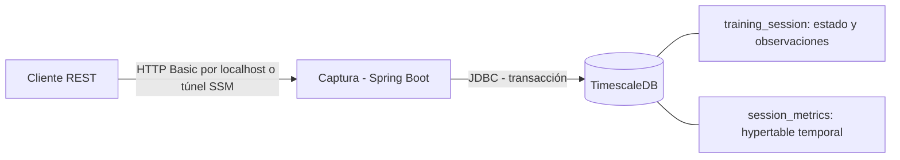

# VeloTrack Captura

Prototipo del microservicio de captura de sesiones para **HU03, HU04 y HU05**, basado en los entregables 1, 2 y 3. Implementado con **Java 21, Spring Boot 4.0.8 y TimescaleDB 2.23.1 / PostgreSQL 17**. Incluye API REST, migraciones Flyway, pruebas, Docker Compose y una plantilla AWS CloudFormation.

## Ejecutar localmente

Requiere Docker Desktop con contenedores Linux y Docker Compose v2.

1. Copiar `.env.example` como `.env`.
2. Definir DB_PASSWORD y CAPTURE_PASSWORD (esta última de al menos 12 caracteres).
3. Ejecutar:

```powershell
docker compose up -d --build --wait
curl.exe http://localhost:8082/actuator/health/readiness
```

La API escucha en http://localhost:8082. El usuario por defecto es `entrenador`; la contraseña es la que configuraste. El puerto de la BD no se publica. Los datos sobreviven a `docker compose down`; no usar `down -v` si se desea conservarlos.

## Probar HU03, HU04 y HU05

Crear una sesión con métricas, indicadores y observaciones (curl solicitará la contraseña):

```powershell
curl.exe -u entrenador -H "Content-Type: application/json" --data-binary "@docs/sesion-completa.json" http://localhost:8082/api/v1/sessions
```

Crear un borrador:

```powershell
curl.exe -u entrenador -H "Content-Type: application/json" --data-binary "@docs/borrador.json" http://localhost:8082/api/v1/sessions
```

Conservar el `id` y la `version` devueltos. Para completar el borrador, enviar el cuerpo completo del ejemplo a `PUT /api/v1/sessions/{id}`, añadiendo `"version":0` (o la versión actual). PUT reemplaza todo el contenido editable; omitir un dato opcional lo limpia. El atleta no se puede cambiar.

Para editar solamente las observaciones:

```http
PATCH /api/v1/sessions/{id}/observations
Content-Type: application/json
Authorization: Basic <credenciales>

{"version":1,"observations":"El atleta recuperó el ritmo al final."}
```

Usar siempre la versión de la última respuesta. Para borrar observaciones enviar null. Una versión obsoleta devuelve 409 y no modifica la sesión. Para programar una sesión, crearla con estado PROGRAMADA y fecha futura; aparecerá en la agenda consultable por API.

Más ejemplos en [docs/api.http](docs/api.http).

## Contrato REST

Todas las rutas `/api/v1/**` requieren HTTP Basic.

| Método | Ruta | Resultado |
|---|---|---|
| POST | /api/v1/sessions | Crea sesión; 201 + Location |
| GET | /api/v1/sessions/{id} | Consulta completa |
| PUT | /api/v1/sessions/{id} | Reemplaza contenido; version obligatoria |
| PATCH | /api/v1/sessions/{id}/observations | Cambia observaciones; version obligatoria |
| GET | /api/v1/athletes/{athleteId}/sessions?from=...&to=... | Historial con métricas y observaciones |
| GET | /api/v1/agenda?from=...&to=...&team=false | Sesiones PROGRAMADA del entrenador |
| GET | /api/v1/agenda?from=...&to=...&team=true | Sesiones PROGRAMADA del equipo dentro de sus permisos |
| GET | /actuator/health/readiness | Salud de aplicación y BD, sin detalles sensibles |

Los listados admiten `limit` (1–100; defecto 50) y `offset` (0–100000; defecto 0), orden descendente por fecha e id. Fechas ISO 8601 con zona horaria, por ejemplo `2026-09-01T00:00:00Z`; rango `[from,to)`. Al usar un offset como `-05:00` en la URL, codificar los caracteres especiales con el cliente HTTP.

Errores: 400 validación, 401 credenciales ausentes/incorrectas, 403 atleta/equipo no autorizado, 404 sesión inexistente, 409 edición concurrente, 503 error de persistencia. Los errores de validación incluyen campos; nunca se devuelven contraseñas ni SQL.

## Reglas funcionales

- BORRADOR y PROGRAMADA pueden omitir métricas. COMPLETADA requiere velocidad de salida, número de vueltas mayor a cero y un tiempo por vuelta.
- Tiempos en segundos, numéricos y mayores que cero. Velocidades en km/h (0–150).
- Máxima y media son valores capturados, no cálculos de HU07. La salida y la media no superan la máxima cuando esta se proporciona.
- Parciales son duraciones de segmentos; la suma no puede superar su vuelta. Intervalos relativos al inicio, ordenados y sin superposición.
- Resistencia: escala subjetiva 0–10. Recuperación: 0–3600 segundos. Ambos son opcionales y sus rangos son decisiones del prototipo.
- Observaciones opcionales de hasta 2000 caracteres, tratadas como texto libre.
- El entrenador y equipo se obtienen de configuración autenticada, no del cuerpo. ATHLETE_IDS controla el alcance.
- La creación y cada edición guardan metadatos y mediciones en una transacción. POST no tiene clave de idempotencia; repetirlo puede crear otra sesión.

## Compilar y probar

Requiere JDK 21 y Maven 3.6.3 o superior. No requiere plugins de IDE.

```powershell
mvn test
mvn verify -Pintegration
```

El primer comando ejecuta pruebas unitarias. El segundo añade pruebas con **TimescaleDB real en Testcontainers** y necesita Docker activo; falla si Docker no está disponible. No sustituye TimescaleDB por H2 ni omite silenciosamente la integración. El JAR ejecutable queda en `target/captura-0.0.1-SNAPSHOT.jar`.

Para ejecutar el JAR fuera de Compose, proporcionar DB_URL, DB_USER, DB_PASSWORD y CAPTURE_PASSWORD; la BD debe tener TimescaleDB. No basta PostgreSQL sin la extensión.

## Estado de verificación

33 pruebas aprobadas: 23 de reglas, API y servicio, y 10 de integración con TimescaleDB real. Migración Flyway, hypertable y persistencia verificadas; JAR generado. La imagen final de la aplicación y el despliegue AWS aún no se han ejecutado. Ver [detalle de validación](docs/VALIDACION.md).

## Diseño y AWS



- [Despliegue paso a paso en AWS](docs/AWS.md).
- [Trazabilidad y simplificaciones de los entregables](docs/TRAZABILIDAD.md).
- [Plantilla CloudFormation](infra/aws.yaml).

Estructura: `session/` agrupa controlador, reglas, servicio y repositorio; `config/` configura autenticación; `db/migration/` define el esquema. La tabla de métricas usa una marca temporal por sesión y JSONB para el detalle de vueltas, evitando múltiples servicios o motores.

Este prototipo tiene un entrenador y un equipo configurables. No incluye interfaz web/móvil, cronómetro, IAM/Talento completos, sincronización offline, analítica, colas ni alta disponibilidad. La ruta AWS usa una instancia EC2 y acceso por SSM; no se creó infraestructura en tu cuenta.

## Referencias técnicas

- [Compatibilidad de Spring Boot 4.0 con Java 21](https://docs.spring.io/spring-boot/4.0/system-requirements.html).
- [API oficial para crear hypertables](https://github.com/timescale/Tiger-Data-Docs/blob/main/src/content/docs/reference/timescaledb/hypertables/create_hypertable.mdx).
- [Imagen TimescaleDB fijada](https://hub.docker.com/layers/timescale/timescaledb/2.23.1-pg17/images/sha256-9f62909205c4501820154e0e60d93ece4f95ed31e792e463d28fc4d914b276cc).
